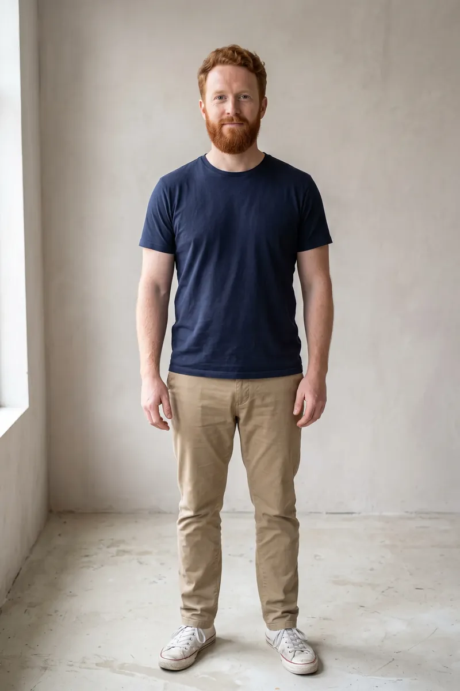
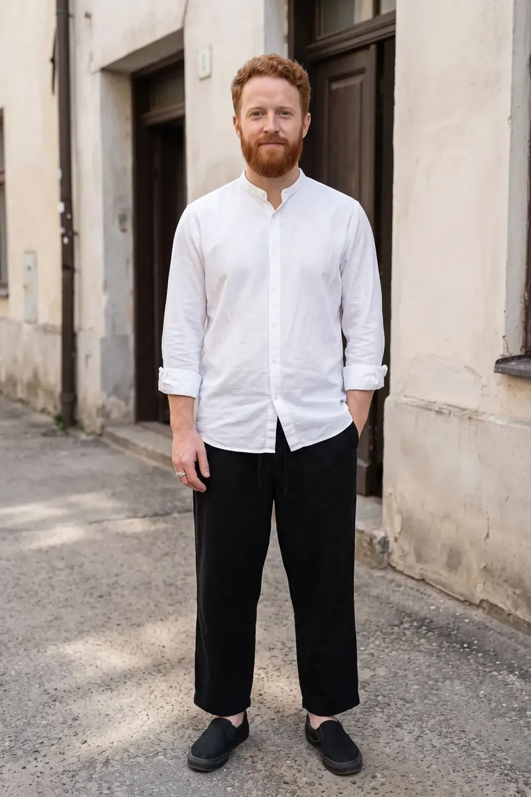
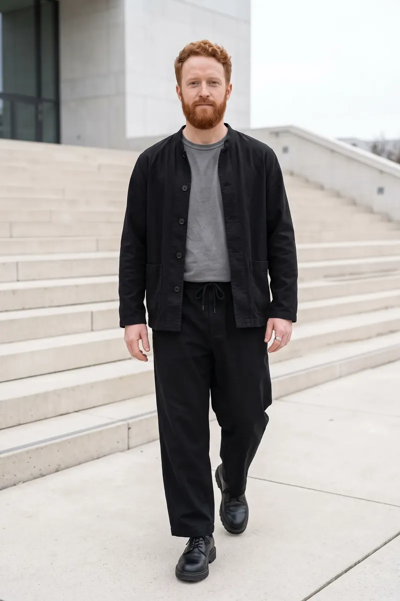
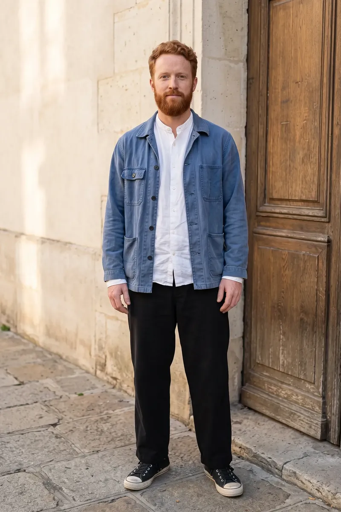
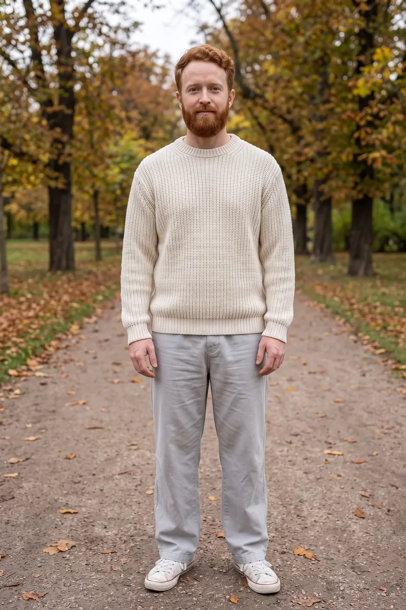
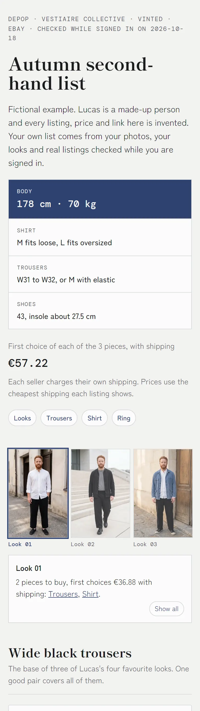

<h1 align="center">Wardrobe Scout</h1>

<p align="center">
  <b>English</b> · <a href="#português">Português</a><br>
  <a href="https://inhabitants.github.io/wardrobe-scout/">Site</a> · <a href="DISCLAIMER.md">Disclaimer / Aviso</a> · <a href="llms.txt">llms.txt</a> · MIT
</p>

---

## English

A Claude Code plugin that shows you what you would look like in new outfits, using your own photo, and then finds those pieces second-hand. You end with a short shopping list of real listings, checked for fabric, size and shipping, on a page you can open on your phone.

> **It never buys anything.** You sign in to the shops yourself, you decide, you pay. Your photos go only to the image provider you choose. Read the [DISCLAIMER](DISCLAIMER.md).

<p>
  
  
  
  
  
</p>

<sub>One photo in, one round of four looks out. Lucas is a synthetic person who does not exist: every image of Lucas was generated, and the shopping list further down is fictional.</sub>

### Why I made this

I'm autistic, and I keep wearing the same fabrics and clothes, the ones that are comfortable for me. But I know that, in the social conversation around fashion, this counts against me, so I wanted to wear things that felt more like me and were comfortable at the same time. Then I realised it was a really complicated task, because buying clothes pushes me either towards the generic or towards ridiculously expensive, out-of-reach collector pieces.

But I thought it could work online: putting together shops, Vinted and the like, I could find mid-range brands, at a good price, in fabrics better than basic plastic. I decided Claude could help me. This is a digital experiment, but a practical one for my everyday life, so that my wife sees me in a better light.

Borderless

### How it works

| Step | Skill | What happens |
|---|---|---|
| 1 | `wardrobe-looks` | You share 1 to 3 photos, your sizes, what is comfortable for you and what you like, and pins of a style you like if you have them. It generates rounds of four full-body looks on your own photo, learns from what you like and dislike, changes a single piece when the rest of a look is right, and finds the few pieces that unlock most of your favourite looks. |
| 2 | `wardrobe-hunt` | In your own browser, signed in to your account, it searches Vinted, Depop, Vestiaire Collective and eBay in several languages, opens each listing, checks fabric, colour, size, condition and shipping, skips fast-fashion copies, and keeps the three best per piece. It can also look for branded pieces far below their shop price. |
| 3 | `wardrobe-list` | It builds one page with every piece, the look it belongs to, three ranked listings with a fit label, the total with shipping, and boxes to tick what you bought. Tap a look and only its pieces light up, with their total. |

### What it pays attention to

- **Your body.** Height, weight and measurements turn into the right sizes per shop. Tags that lie ("fits like a 41") and very large sizes on a slim body get flagged.
- **Your comfort.** Fabrics that itch, tight waists, belts, heavy shoes: whatever bothers you becomes a rule.
- **What the listing really says.** A title that says "cotton" and details that say "polyester and wool" get caught.
- **The full price.** Price, buyer fee and the cheapest shipping to you, per seller.
- **Your taste, learned.** Every dislike becomes a rule for the next round, and the pattern of your favourites becomes the shopping list.
- **A trend without the cheap copy.** From your pins it keeps the cut and the colours and swaps the fabric for one that lasts and that you can wear all day. In the shops it searches the real garment, brand or fabric, never the trend word, which pulls in fast-fashion copies.
- **One piece at a time.** Like a look except for the shoes? It changes only the shoes, checks that the trousers still fall over them, and takes the old pair off the list.
- **What you already own.** Pieces you love wearing go into the looks on purpose and count as zero on the list, so you only buy what is missing.
- **Measurements, not tags.** Measure one garment that fits you, once. Listings that give measurements are compared with it, centimetre by centimetre.
- **A question for the seller, ready.** When a listing leaves something out, the page has a message in the seller's language, one tap to copy. You send it; the plugin never does.
- **Sold is sold.** Come back later and it rechecks the list: sold listings leave, and the next one takes their place.

### Install

In Claude Code:

```
/plugin marketplace add inhabitants/wardrobe-scout
/plugin install wardrobe-scout@wardrobe-scout
```

Then say something like *"help me find a new style with my photo"*.

You need:

- **An image API key** from one provider: `OPENAI_API_KEY`, `GEMINI_API_KEY` or `FAL_KEY`, set as an environment variable. Each image is billed by the provider to your account. GPT Image 2.5 kept the face best in our tests, and a fal key reaches it too.
- **Python 3.9 or newer.** The scripts use only the standard library.
- **A browser Claude can use** for the shop search, such as the browser built into the Claude app or the Claude in Chrome extension.

### What you get

```
wardrobe/
  profile.md          your sizes, comfort rules, likes, dislikes, pieces to find
  photos/             your reference photos (stay on your computer)
  looks/round-01/     each look as an image plus the prompt that made it
  finds.json          the listings found, checked and ranked
  shopping-list.html  the page for your phone
```

A fictional example of the list is in [`examples/`](examples): `finds.example.json` and the page built from it, `shopping-list.example.html`.

<p align="center">
  <picture>
    <source media="(prefers-color-scheme: dark)" srcset="site/img/list-top-dark.webp">
    
  </picture>
</p>

<p align="center"><sub>Lucas's fictional list at phone width. Every listing, price and link in it is made up.</sub></p>

### What it does not do

- Buy, pay, make offers or message sellers.
- Type your passwords or card details.
- Scrape shops. It browses like a person, one listing at a time, in your own browser.
- Change your face or body in the images, or generate images of anyone who did not agree to it.

---

## Português

Um plugin do Claude Code que mostra como você ficaria com roupas novas, usando a sua própria foto, e depois acha essas peças usadas. No fim você tem uma lista curta de anúncios reais, conferidos em tecido, tamanho e envio, numa página que abre no celular.

> **Ele nunca compra nada.** Você entra nas lojas com a sua conta, decide e paga. As suas fotos vão só pro provedor de imagem que você escolher. Leia o [AVISO](DISCLAIMER.md#português).

<p>
  
  
  
  
  
</p>

<sub>Uma foto entra, uma rodada de quatro looks sai. O Lucas é uma pessoa sintética, que não existe: toda imagem do Lucas foi gerada, e a lista de compras mais abaixo é fictícia.</sub>

### Por que eu fiz isso

Sou autista, e fico usando com frequência os mesmos tecidos e roupas que são confortáveis para mim. Porém sei que isso, em relação à conversa social de moda, é negativo, e assim queria vestir coisas que sentisse mais como eu e que ao mesmo tempo fossem confortáveis. Mas percebi que era uma tarefa muito complicada, porque comprar roupas me empurra para o genérico ou para coisas ridiculamente caras e inacessíveis, de colecionador.

Porém pensei que online seria possível: associando lojas, Vinted e coisas do tipo, poderia encontrar marcas medianas, a bom custo, e tecidos acima do plástico básico. Resolvi que o Claude podia me ajudar. Este é um experimento digital, mas prático para o meu dia a dia, a fim de deixar minha esposa olhando para mim com melhores olhos.

Borderless

### Como funciona

| Passo | Skill | O que acontece |
|---|---|---|
| 1 | `wardrobe-looks` | Você manda de 1 a 3 fotos, seus tamanhos, o que é confortável pra você e do que gosta, e pins de um estilo que curtiu, se tiver. Ele gera rodadas de quatro looks de corpo inteiro na sua foto, aprende com o que você curte e o que não curte, troca uma peça só quando o resto do look está certo, e acha as poucas peças que montam a maior parte dos seus looks favoritos. |
| 2 | `wardrobe-hunt` | No seu navegador, logado na sua conta, ele procura no Vinted, Depop, Vestiaire Collective e eBay em várias línguas, abre cada anúncio, confere tecido, cor, tamanho, estado e envio, descarta cópia de fast fashion, e fica com os três melhores de cada peça. Também procura peças de marca bem abaixo do preço de loja. |
| 3 | `wardrobe-list` | Ele monta uma página com cada peça, o look a que ela pertence, três anúncios em ordem com uma etiqueta de caimento, o total com envio e caixas pra marcar o que você comprou. Toca num look e só as peças dele acendem, com o que falta comprar. Cada anúncio que deixou algo de fora traz a pergunta pronta pro vendedor, na língua dele. |

<p align="center">
  <picture>
    <source media="(prefers-color-scheme: dark)" srcset="site/img/list-top-dark.webp">
    
  </picture>
</p>

<p align="center"><sub>A lista fictícia do Lucas, em largura de celular. Todo anúncio, preço e link dela é inventado. O exemplo está em <a href="examples"><code>examples/</code></a>.</sub></p>

### Instalar

No Claude Code:

```
/plugin marketplace add inhabitants/wardrobe-scout
/plugin install wardrobe-scout@wardrobe-scout
```

Depois diga algo como *"me ajuda a mudar meu estilo com a minha foto"*.

Você precisa de:

- **Uma chave de API de imagem** de um provedor: `OPENAI_API_KEY`, `GEMINI_API_KEY` ou `FAL_KEY`, como variável de ambiente. Cada imagem é cobrada pelo provedor na sua conta. O GPT Image 2.5 foi o que melhor segurou o rosto nos testes, e uma chave do fal também chega nele.
- **Python 3.9 ou mais novo.** Os scripts usam só a biblioteca padrão.
- **Um navegador que o Claude consiga usar** pra procurar nas lojas, como o navegador do app do Claude ou a extensão Claude in Chrome.

### O que ele não faz

- Comprar, pagar, fazer oferta ou mandar mensagem pra vendedor.
- Digitar a sua senha ou os dados do seu cartão.
- Raspar as lojas. Ele navega como uma pessoa, um anúncio por vez, no seu navegador.
- Mudar o seu rosto ou o seu corpo nas imagens, ou gerar imagem de quem não concordou.
